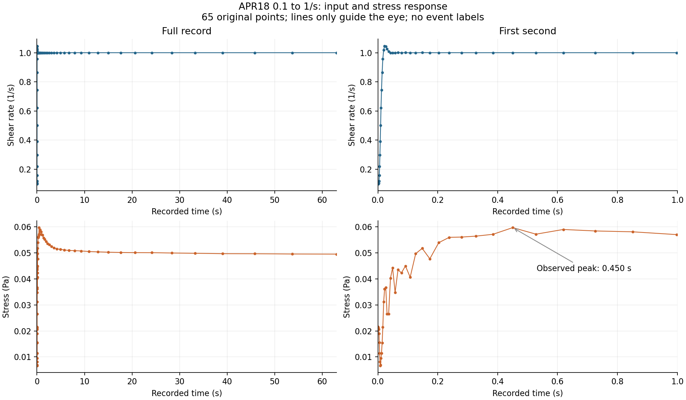
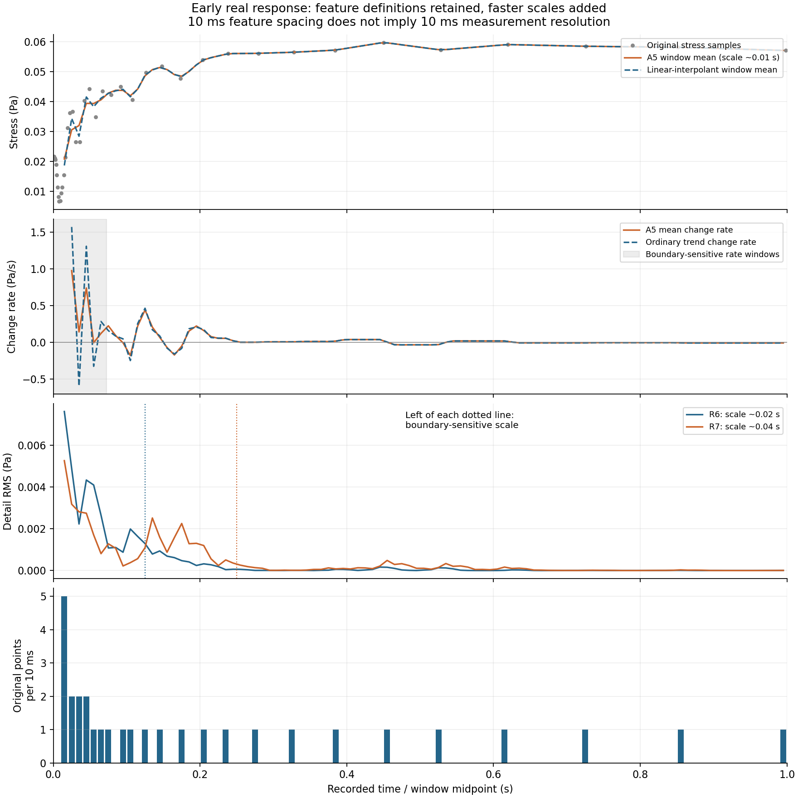
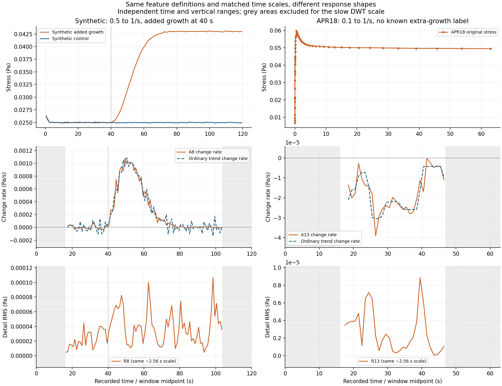
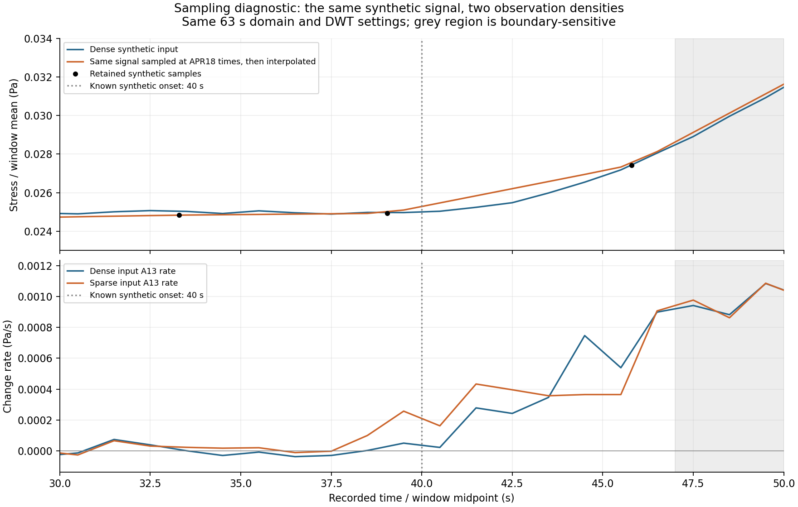

# APR18 STEP 与人造 step：DWT 特征对照结果

## 这轮回答了什么

按照用户确认的范围，研究 APR18 steps!BH4:BK68 的 **0.1→1 s⁻¹完整响应**，再与之前的人造 control_1/test_clot_1 作特征对照。

**近似趋势变化率能表达应力上升或下降，但本轮没有证明 DWT 比普通趋势更好地定位变化。真实数据的细节强度对计算起点和原始采样密度敏感，不能直接把每个峰解释为物理事件或噪声。**

本轮是已完成的描述性特征实验，不是已完成的真实变化点检测器。没有拟合物理模型、训练 ML、设报警门槛或给出真实检出准确率。

## 1. 数据选择与可比性

APR18 有 7 条不同数值的有效阶跃，本轮选先前已经检查的 BH–BK。选择依据是明确的输入输出、完整的原始记录和连续的研究范围，不是看到本次特征后挑选成功案例。

| 项目 | 之前的人造长记录 | 本轮 APR18 |
|---|---|---|
| 协议 | 0.5→1 s⁻¹ | 0.1→1 s⁻¹ |
| 数据 | control_1 与 test_clot_1 | BH–BK 一条记录 |
| 时间 | 0–120 s | 0.000795573–63.0007 s |
| 原始采样 | 12,001 点、100 Hz 均匀 | 65 点、明显不均匀 |
| 变化背景 | 人为在 40 s 后添加应力增长 | 观测到加载后的上升、峰值和回落，没有额外增长标签 |
| 无增长对照、干净真值 | 人造数据包提供 | 本条真实记录没有 |

两者不是同条件、同样本的重复实验。这里只比较特征定义和它们能表达的信号变化，不能用曲线差异反推模型拟合精度或生物机制。

工作簿 F、AS、AX 为完全相同的数值，F/AX 标题与实测输入不符；未把它们算作额外实验。另有人造 cal_02_0p1_to_1.csv 与 BH 名义协议相同，但仅 66 点、0–5 s、非均匀采样，本轮不把它当作先前的均匀长记录。

## 2. 怎么做

1. 保留 65 个原始时间、应力、应变和剪切率数值；全部原始点作为线性插值锚点。保持原始时间原点，既不把首点改成触发时刻，也不外推记录前历史。
2. 建立含 201,601 点的等时间计算网格，步长约 0.0003125 s，严格保留记录两端；再用 403,201 和 806,401 点的嵌套网格核验。计算点不是新增实验点，不做幅值归一化或阈值去噪。
3. 全记录、离线 db2 DWT，symmetric 延拓。保存重构近似分量的窗口均值、相邻均值变化率、各层细节的 RMS 强度。普通参照是通过原始点的分段线性曲线在窗口中的精确时间平均及其变化率，明确含插值假设。
4. 按物理尺度匹配：人造数据 D1–D8 的尺度指标约为 0.02–2.56 s；在真实数据的细网格上对应 D6–D13。人造 A8 与本轮 A13 对应相同约 2.56 s 尺度指标。**层号变了，不等于研究问题变了。** 尺度指标 2^jΔt 不等于精确事件持续时间。
5. 慢尺度使用 1 s 窗口。为观察前 1 s，补充 A5（尺度指标约 0.01 s）及 R6/R7（约 0.02/0.04 s），使用 10 ms 窗口；这部分是较快尺度的补充，不能称直接复用了人造 A8。十毫秒输出间隔不等于十毫秒定位精度。
6. 边界工程筛查为两端各排除 6.25 倍尺度指标；慢尺度约为 16 s。变化率要求前后两个窗口都有效。保留所有 CSV 数值，但在主要慢尺度结果图中不显示被排除窗口的曲线。原始完整响应另图展示。
7. 对剪切率和应力两通道均提取特征；没有设置“加载稳定”的判定门槛。通过原始观测范围描述输入与输出是否还在变化。

每个窗口保存原始点数、跨越的最大原始采样间隔。原始空隙大于尺度只作为支持不足的提示，小于尺度也不自动证明采样充分。

## 3. 真实曲线发生了什么

原始应力先下降，在 **0.00787565 s** 的采样点达到 **0.00667988 Pa**，随后带着局部起伏上升，在 **0.450381 s** 达到观测最大值 **0.05972 Pa**，再总体回落。末点应力为 **0.0495283 Pa**，比观测峰值低约 **17.1%**。这些是离散原始点的值，不是 DWT 找到的变化时刻，也不能证明两个采样点之间没有更高峰或更低谷。

在 0.042–1 s 内，已记录剪切率为 0.998548–1.0008 s⁻¹，但应力仍明显起伏、上升并经过峰值。因此可以说：**在已测得的输入变化已经很小的阶段，输出仍在变化。** 这没有证明采样空隙中加载始终稳定，也没有识别 rouleaux。

最早的谷值接近记录边界；本轮不能用经过边界筛查的这些 DWT 尺度，给它一个经过独立验证的起点定位。

## 4. 哪些特征有用

| 特征 | 人造 step 中表现 | APR18 中表现 | 本轮判断 |
|---|---|---|---|
| 近似趋势均值与变化率 | 增长段趋势升高、变化率持续为正 | 较快近似趋势显示前段上升与回落；匹配慢尺度的后段变化率为负 | 可以描述变化方向；尚不证明精准起点或 DWT 优越性 |
| 普通趋势变化率 | 同样反映增长 | 同样反映上升、峰后回落和后段缓慢下降 | 必须保留；这里的普通趋势也依赖真实点之间的插值 |
| 各层细节强度 Rj | 慢增长在较慢尺度更明显，但存在额外峰和对齐影响 | 前段快速尺度较活跃，后段仍可出现细节峰；稀疏区很多峰受插值与对齐影响 | 可作为“哪里有局部活动”的辅助，不能直接作为已确认变化点 |
| 快尺度强度作为噪声指标 | 可用干净信号对照，检查哪些部分与噪声有关 | 没有独立无噪声真值，而且真实快速响应也可能进入快尺度 | 不能把它解释为纯噪声，更不能据此直接删除这些细节 |

在描述性区间汇总中：人造增长的 40–70 s 内，29 个有效相邻窗口变化率全部为正，A8 变化率平均约 **+6.046×10⁻⁴ Pa/s**；APR18 的 18–47 s 内，要求前后两窗均落在区间后，28 个有效变化率全部为负，A13 变化率平均约 **−1.738×10⁻⁵ Pa/s**。这是不同变化形状的描述，不是同一事件的性能排名；原始点很稀疏，不能把这些窗口当作独立重复实验。

## 5. 为什么不能直接取小波峰作为变化点

### 数值加密与对齐是两回事

保留相同物理尺度加密网格后，原始峰谷及插值保真改善。主网格的最大应力回插误差约为原始值域的 **0.332%**，两次加密后约为 **0.162%、0.087%**。原始极值附近幅度、全局极值时间和逆变换均已核验。

应力的有效窗口中，从主网格到四倍密度网格，早期 A5 变化率相对 L2 差约 **2.20%**，R6/R7 强度约 **3.81%/3.62%**；这些表示所选插值函数的计算在加密后较接近，并不代表复原了真实未采样波形。

但只将分解起点向后移动约 **0.005 s**，在共同、通过边界筛查的早期窗口中，A5 变化率相对 L2 差约 **14.9%**，R6/R7 约 **47.4%/48.2%**。移动约 **0.32 s** 时，后段 A13 变化率与 R13 的相对 L2 差约 **18.1%/30.9%**。这些是特征差异，不是材料变化百分比或时间误差。

因此，不能把网格加密较稳定写成“整个 DWT 检测稳定性通过”。这里主要支持宽范围趋势的解释，不支持把单个细节峰当作精确事件。

### 稀疏采样本身就会改变特征

BH 在 1–63 s 的 62 个一秒窗口中，**43 个没有原始测量点**。它们的计算特征由两侧数据插值决定。

为单独检查这一影响，本轮增加了一个明确标为诊断的计算：把原来的人造信号在 APR18 的采样时间上求值，再插值回同一个细网格，与同样截取到约 63 s 的密集版本比较。两者使用相同分析域、分解起点、物理尺度和窗口，只改变可用观测密度。人造数据的非网格时刻值通过原密集记录的线性插值得到，不是新生成的独立测量。

40 s 起点被夹在 **39.0485–45.7985 s** 的两个保留时间点之间。连接两点的线段把增长分摊到这段区间，使 A13 变化率的形状和起点附近响应改变；即使没有更换物理信号，也能产生差异。

这解释了为什么真实数据上的细节响应不能只用“血液与人造数据物理性质不同”来解释，还必须考虑采样、插值和 DWT 对齐。

## 6. 验证、文件与下一步

已经执行并核验：所有源文件哈希不变、原始 CSV 导出逐值一致；三种网格保真与极值时间；逆变换误差；近似与细节的重构关系；常量细节接近零；线性趋势变化率与精确积分；首个差分为空值；物理尺度匹配；全部提取层级的加密、边界与起点敏感性。之前两条人造记录的主要特征重新计算后，与旧结果的最大绝对差小于 **10⁻¹²**。

实际配置、环境版本和验证结果见 `03_checks/validation.json`。逐特征稳定性见 `03_checks/feature_sensitivity.csv`。所有代码为 Python，含英文说明；`run_experiment.py` 按顺序重现，`README.md` 说明文件组织和字段含义。

**当前限制：** 一条真实阶跃；无独立事件标签、噪声记录、加载触发时刻与完整预历史；两类信号的协议和响应形状不同；没有比较真实检测准确率，没有把特征解释为凝血或红细胞聚集的直接证据。

建议下一阶段先核对本轮四张图和特征含义，再决定是否制定“宽时间区间”的变化规则。暂不根据这些结果反复调参，使某个峰对齐到预想的变化时刻。
